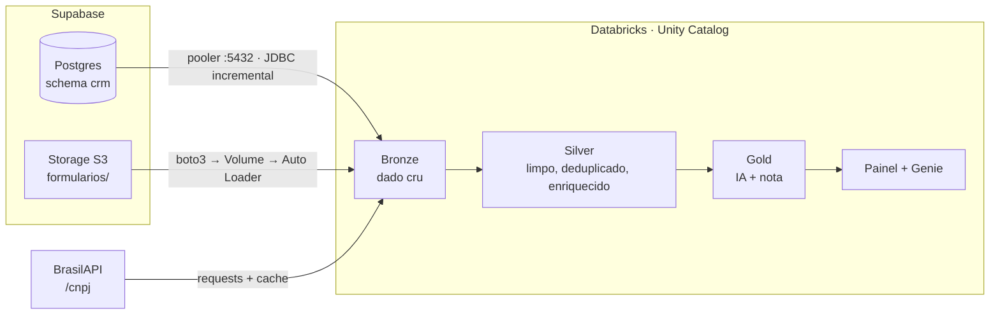

# PRD · Call First · Priorização Inteligente de Leads

> **Engenharia de dados + IA aplicada a vendas com Databricks**

| Campo | Valor |
|---|---|
| Versão | 1.0 |
| Status | Especificado, aguardando desenvolvimento |
| Responsável | Alerrandro |
| Data | 31/10/2026 |
| Cliente (cenário) | Atlas Software, empresa fictícia de software B2B |
| Uso | Workshop de ~50 min para engenheiros e analistas de dados |

---

## Como ler este documento

Este PRD segue uma metodologia em **três fases, cada uma com um portão de aprovação**. Nenhuma fase começa sem que a anterior tenha cumprido seus critérios de saída.

```
 1. IDENTIFICAR          2. ESPECIFICAR            3. VALIDAR
 qual é o problema?  →   o que será entregue?  →   como provamos que funciona?
 quem sofre com ele?     com quais regras?         e que gera valor?
 quanto custa hoje?      com quais dados?
        │                        │                         │
   [Portão 1]               [Portão 2]                [Portão 3]
 problema e métrica      requisitos com ID e       critérios de aceite
 aprovados               critério de aceite        aprovados → entrega
```

Cada requisito tem um **ID rastreável** (`RF-xx`, `RNF-xx`, `CA-xx`). A seção 4 traz a matriz que liga problema → requisito → critério de aceite → marco de desenvolvimento.

---

# FASE 1 · IDENTIFICAÇÃO

## 1.1 Contexto

A Atlas Software vende cinco produtos por assinatura: Atlas Gestão (ERP), Atlas BI, Atlas Fiscal, Atlas CRM e Atlas Estoque. Os leads chegam por cinco canais (site, eventos, indicação, outbound e LinkedIn) e são trabalhados por um time de **8 vendedores**, divididos por região e segmento.

## 1.2 Declaração do problema

> **O time comercial recebe cerca de 300 leads por semana e os atende por ordem de chegada, sem saber quais estão prontos para comprar. Leads com alta intenção esfriam na fila, enquanto o time gasta tempo com curiosos, pedidos de suporte e spam. A conversão está em torno de 3%.**

## 1.3 Linha de base (situação atual)

| Indicador | Hoje | Fonte |
|---|---|---|
| Volume de leads | ~300 por semana | CRM |
| Critério de atendimento | Ordem de chegada | Processo comercial |
| Conversão lead → venda | ~3% | Oportunidades ganhas ÷ leads |
| Classificação da intenção | Inexistente: o vendedor lê cada mensagem | Formulários |
| Dados da empresa do lead | Digitados à mão e incompletos | CRM |

## 1.4 Causa-raiz (5 porquês)

1. **Por que a conversão é baixa?** Porque os leads quentes demoram a ser contatados.
2. **Por que demoram?** Porque ficam na mesma fila dos leads frios.
3. **Por que estão na mesma fila?** Porque não existe critério de prioridade.
4. **Por que não existe critério?** Porque a informação que indica intenção está espalhada: histórico no CRM, texto livre no formulário e porte da empresa fora de qualquer sistema.
5. **Por que está espalhada?** Porque não há um pipeline que una as fontes e interprete o texto livre.

**Causa-raiz:** falta de integração entre as fontes e de interpretação automática da mensagem do lead.

## 1.5 Stakeholders e necessidades

| Persona | Necessidade | Decisão que o produto apoia |
|---|---|---|
| **Vendedor** | Saber para quem ligar primeiro e o que dizer | Ordem de contato e abordagem |
| **Gestor comercial** | Enxergar o funil e cobrar o time com base em dados | Distribuição de leads e metas |
| **Marketing** | Saber quais canais e campanhas trazem leads quentes | Alocação de verba |
| **Engenharia de dados** | Pipeline confiável, reprocessável e governado | Arquitetura e operação |
| **Analista de dados** | Dados limpos e prontos para análise | Indicadores e estudos |

## 1.6 Hipótese de valor

> **Se** unirmos CRM, formulários e dados cadastrais da empresa num pipeline único, **e** usarmos IA para classificar a intenção do texto livre, **então** o time contatará primeiro os leads com maior chance de compra, **e** a conversão subirá sem aumentar o tamanho do time.

## 1.7 Métricas de sucesso

| Tipo | Métrica | Meta |
|---|---|---|
| ⭐ Negócio (principal) | Conversão lead → oportunidade nos leads do top 20% da fila | ≥ 2× a linha de base |
| Negócio | Leads "compra imediata" contatados em até 24 h | ≥ 90% |
| Operação | Tempo médio até o primeiro contato de lead quente | Redução ≥ 50% |
| IA | Acurácia da classificação de intenção contra o gabarito | ≥ 85% |
| Dados | Leads duplicados na camada Silver | 0 |

### ✅ Portão 1: critérios de saída
- [x] Problema declarado em uma frase e aceito pelo negócio
- [x] Linha de base medida
- [x] Causa-raiz identificada
- [x] Métricas de sucesso com meta numérica

---

# FASE 2 · ESPECIFICAÇÃO

## 2.1 Escopo

**Dentro do escopo (MVP)**
- Ingestão das três fontes: banco, arquivos e API.
- Limpeza, deduplicação e enriquecimento.
- Classificação de intenção, extração de entidades e resumo por IA.
- Nota de prioridade (0 a 100) e próximo passo sugerido.
- Painel com a fila priorizada e perguntas em linguagem natural.

**Fora do escopo (versões futuras)**
- Escrever a nota de volta no CRM (reverse ETL).
- Disparo automático de e-mails ou mensagens.
- Modelo de ML treinado sob medida. No MVP, usamos regras combinadas com LLM.
- Atendimento em tempo real (streaming abaixo de 1 minuto).

## 2.2 Histórias de usuário

| ID | Como... | Quero... | Para... |
|---|---|---|---|
| US-01 | vendedor | abrir o dia com os leads ordenados por prioridade | ligar primeiro para quem vai comprar |
| US-02 | vendedor | ler um resumo de uma linha do lead | não precisar abrir cada formulário |
| US-03 | vendedor | ver um próximo passo sugerido | agir mais rápido |
| US-04 | gestor | perguntar em português sobre a fila | tirar dúvidas sem depender de um analista |
| US-05 | marketing | ver a intenção por canal e campanha | investir nos canais que trazem compradores |
| US-06 | eng. de dados | reprocessar qualquer fonte sem duplicar dados | operar com segurança |

## 2.3 Fontes de dados

| Fonte | Tecnologia | Conteúdo | Acesso | Frequência | Chave |
|---|---|---|---|---|---|
| **CRM** | Supabase Postgres, schema `crm` | 320 leads, 8 vendedores, 5 produtos, ~110 oportunidades, ~430 interações | Session pooler :5432, usuário somente leitura | Incremental por `atualizado_em` | `leads.id` |
| **Formulários** | Supabase Storage (API S3), bucket `formularios/entrada/` | JSON Lines com mensagem em texto livre e UTM | boto3 → Volume UC → Auto Loader | A cada chegada de arquivo | `form_id`, e-mail normalizado |
| **Cadastro da empresa** | BrasilAPI `/api/cnpj/v1/{cnpj}` | Razão social, porte, CNAE, município, UF, situação | HTTPS, com cache em Volume | Sob demanda (CNPJ novo) | CNPJ (14 dígitos) |

## 2.4 Requisitos funcionais

### Ingestão (Bronze)
| ID | Requisito |
|---|---|
| RF-01 | Ler as tabelas do CRM de forma **incremental** pela coluna `atualizado_em`. |
| RF-02 | Copiar do Storage apenas os **arquivos novos** para um Volume e ingeri-los com Auto Loader. Cada arquivo é processado uma única vez. |
| RF-03 | Consultar a BrasilAPI apenas para CNPJs **ainda não presentes no cache**. |
| RF-04 | Guardar na Bronze o dado como veio, com colunas técnicas: `_fonte`, `_arquivo`, `_ingerido_em`. |

### Tratamento (Silver)
| ID | Requisito |
|---|---|
| RF-05 | Normalizar o CNPJ para 14 dígitos e validar o dígito verificador. Inválidos recebem `cnpj_valido = false`. |
| RF-06 | Normalizar o e-mail (minúsculas, sem espaços) e **deduplicar** os leads entre CRM e formulários. |
| RF-07 | Remover envios idênticos repetidos (mesmo e-mail e mesma mensagem em até 5 minutos). |
| RF-08 | Enriquecer cada lead com o cadastro da empresa via CNPJ. Sem CNPJ ou com CNPJ inválido, o lead segue com os campos de empresa nulos. |
| RF-09 | Aplicar regras de qualidade declarativas (expectations) e registrar as violações. |

### Inteligência (Gold)
| ID | Requisito |
|---|---|
| RF-10 | Classificar a intenção da mensagem em `compra imediata`, `pesquisa`, `suporte` ou `spam`. |
| RF-11 | Extrair da mensagem: produto, quantidade, prazo e orçamento, quando houver. |
| RF-12 | Gerar um resumo de até 15 palavras e um próximo passo sugerido. |
| RF-13 | Calcular a nota de prioridade de 0 a 100, conforme a regra 2.6. |
| RF-14 | Publicar a tabela `gold.fila_priorizada`, ordenada pela nota. |

### Consumo
| ID | Requisito |
|---|---|
| RF-15 | Painel com a fila, filtros por vendedor, região e intenção, e indicadores do funil. |
| RF-16 | Espaço de perguntas em linguagem natural (Genie) sobre as tabelas Gold. |

## 2.5 Requisitos não funcionais

| ID | Categoria | Requisito |
|---|---|---|
| RNF-01 | Idempotência | Reprocessar qualquer etapa não pode duplicar registros. |
| RNF-02 | Frescor | Um lead novo aparece na fila em até 1 dia. |
| RNF-03 | Segurança | Credenciais em secret scope. O banco é acessado por usuário somente leitura. |
| RNF-04 | Governança | Todas as tabelas no Unity Catalog, com linhagem e comentários. |
| RNF-05 | Custo | A IA processa apenas leads **novos ou alterados**, nunca a base inteira a cada execução. |
| RNF-06 | Resiliência | Falhas da API não interrompem o pipeline: o lead segue sem enriquecimento e é reprocessado depois. |
| RNF-07 | Privacidade (LGPD) | Dados pessoais restritos às camadas necessárias. O painel do marketing mostra apenas dados agregados. |
| RNF-08 | Explicabilidade | A nota sempre mostra seus componentes (intenção, porte, histórico, recência). |

## 2.6 Regras de negócio

### Nota de prioridade (0 a 100)

```
nota = 0,50 × intenção + 0,20 × porte + 0,15 × histórico + 0,15 × recência
```

| Componente | Como é calculado |
|---|---|
| **Intenção** (IA) | compra imediata = 100 · pesquisa = 40 · suporte = 10 · spam = 0 |
| **Porte** (API) | Demais/grande = 100 · EPP = 60 · ME = 30 · desconhecido = 20 |
| **Histórico** (CRM) | Taxa de conversão histórica da empresa ou do CNAE, escalada para 0 a 100 |
| **Recência** | 100 no dia da chegada, caindo linearmente até 0 em 30 dias |

**Travas:** `spam` → nota máxima de 5 e próximo passo "Descartar". `suporte` → nota máxima de 25 e próximo passo "Encaminhar ao suporte".

### Deduplicação
- **Chave:** e-mail normalizado.
- **Sobrevivência:** cadastro do CRM, mais a mensagem mais recente do formulário.

## 2.7 Especificação da IA

| Tarefa | Função Databricks | Entrada | Saída |
|---|---|---|---|
| Intenção | `ai_classify` | `mensagem` | Um dos 4 rótulos |
| Entidades | `ai_extract` | `mensagem` | `produto`, `quantidade`, `prazo`, `orcamento` |
| Resumo e próximo passo | `ai_query` com prompt fixo | Mensagem e dados do lead | Texto curto em português |

**Salvaguardas**
- A IA **sugere**; a decisão continua com o vendedor.
- Uma mensagem vazia ou com menos de 5 caracteres recebe `spam` sem chamar a IA.
- O prompt do resumo e a versão do modelo ficam registrados junto com o resultado, para auditoria.

## 2.8 Arquitetura



### Decisões de arquitetura

| # | Decisão | Motivo | Alternativa descartada |
|---|---|---|---|
| D-01 | Conectar ao Postgres pelo **Session pooler** | A conexão direta do Supabase é só IPv6; o pooler aceita IPv4 | Add-on de IPv4 (pago) |
| D-02 | Storage → **Volume** → Auto Loader | Endpoints S3 fora da AWS não podem ser external location no Unity Catalog | Configurar `fs.s3a.endpoint` (não suportado no serverless) |
| D-03 | **Cache** das respostas da BrasilAPI | A API é pública e tem limite de chamadas | Consultar a cada execução |
| D-04 | IA com **AI Functions direto no SQL** | Simples, governado e sem infraestrutura extra | Endpoint de modelo próprio |
| D-05 | Nota por **regra explícita** no MVP | Explicável e validável com o negócio | Modelo de ML (fica para a v2) |

## 2.9 Modelo de dados (Gold)

**`gold.fila_priorizada`**

| Coluna | Tipo | Descrição |
|---|---|---|
| `lead_id` | bigint | ID do lead no CRM, ou um ID gerado quando o lead veio só do formulário |
| `nome`, `email`, `empresa` | string | Identificação |
| `porte`, `cnae`, `uf` | string | Dados vindos da API |
| `intencao` | string | Rótulo da IA |
| `produto`, `quantidade`, `prazo` | string | Entidades extraídas |
| `resumo`, `proximo_passo` | string | Texto gerado |
| `nota` | int | Nota de 0 a 100 |
| `nota_componentes` | struct | Intenção, porte, histórico e recência (RNF-08) |
| `vendedor`, `status` | string | Situação atual no CRM |
| `atualizado_em` | timestamp | Último processamento |

### ✅ Portão 2: critérios de saída
- [x] Escopo e fora de escopo definidos
- [x] Todo requisito tem ID e pelo menos um critério de aceite (seção 3.1)
- [x] Fontes, acesso e frequência confirmados
- [x] Regra da nota aprovada pelo negócio
- [x] Decisões de arquitetura registradas

---

# FASE 3 · VALIDAÇÃO

## 3.1 Critérios de aceite

Os critérios usam o **dataset de referência do projeto**, que já contém problemas planejados e um gabarito.

| ID | Valida | Critério de aceite |
|---|---|---|
| CA-01 | RF-01 | Após rodar `03_novos_leads_ao_vivo.sql`, a carga seguinte traz **exatamente 5** leads novos. |
| CA-02 | RF-02, RNF-01 | Subir o lote ao vivo gera **exatamente 20** registros novos. Rodar de novo gera 0. |
| CA-03 | RF-03 | A segunda execução faz **0 chamadas** à API para CNPJs já em cache. |
| CA-04 | RF-05 | Os CNPJs com e sem máscara convergem para o mesmo valor. Os 3 inválidos ficam com `cnpj_valido = false`. |
| CA-05 | RF-06, RF-07 | A Silver tem **0 e-mails duplicados**. O envio em duplo clique aparece uma única vez. |
| CA-06 | RF-08, RNF-06 | Leads sem CNPJ ou com CNPJ inválido chegam à Gold, com os campos de empresa nulos. |
| CA-07 | RF-10 | A acurácia contra `gabarito/intencao_formularios.csv` (171 mensagens) é **≥ 85%**. |
| CA-08 | RF-10 | Pelo menos **4 das 5 pegadinhas** do lote ao vivo são classificadas corretamente. |
| CA-09 | RF-11 | Na mensagem das "200 licenças", a extração traz produto = Atlas Gestão, quantidade = 200 e prazo = dezembro. |
| CA-10 | RF-13 | Nenhum lead `spam` tem nota acima de 5, e nenhum `suporte` passa de 25. |
| CA-11 | RF-14, RNF-08 | A fila está ordenada por nota, e todo registro tem os 4 componentes preenchidos. |
| CA-12 | RF-16 | O Genie responde corretamente: "quais leads quentes de indústria ainda não foram contatados?" |
| CA-13 | RNF-02 | Do upload do arquivo até o lead aparecer na fila: ≤ 15 minutos. |
| CA-14 | RNF-05 | A segunda execução sem dados novos faz **0 chamadas** de IA. |

## 3.2 Plano de testes

| Nível | O que testa | Como |
|---|---|---|
| Dados | Contagens, unicidade, nulos, formatos | Expectations no pipeline e consultas de conferência |
| Regras | Nota, travas, deduplicação | Casos montados com resultado esperado |
| IA | Acurácia por rótulo e matriz de confusão | Comparação com o gabarito |
| Ponta a ponta | Do dado novo na fonte até a fila | Roteiro da demo, com cronômetro |
| Resiliência | API fora do ar, arquivo malformado | Simulação de falha |

## 3.3 Validação de valor com o negócio (backtest)

Antes de entrar em produção, a nota é aplicada aos leads **históricos**, cujo desfecho já é conhecido (oportunidade ganha ou perdida). A pergunta é:

> **Os leads no top 20% da nota converteram pelo menos 2× mais que a média?**

Se sim, a hipótese de valor (1.6) está sustentada. Se não, os pesos da nota (2.6) são recalibrados com o negócio antes da entrega.

## 3.4 Riscos e mitigações

| Risco | Prob. | Impacto | Mitigação |
|---|---|---|---|
| Free Edition bloqueia a saída para Supabase e BrasilAPI | Alta | Alto | Testar a rede primeiro (notebook 00); verificação com LinkedIn ou trial em cloud |
| BrasilAPI instável ou com limite de chamadas | Média | Médio | Cache em Volume e reprocessamento posterior |
| IA classifica errado | Média | Médio | Gabarito, travas da nota e decisão final humana |
| Custo de IA cresce com o volume | Baixa | Médio | Processar apenas o incremental (RNF-05) |
| Falha ao vivo na demo | Média | Alto | Pipeline pré-executado e vídeo de backup |

### ✅ Portão 3: critérios de saída (entrega)
- [ ] CA-01 a CA-14 aprovados
- [ ] Backtest com top 20% ≥ 2× a média
- [ ] Riscos altos mitigados
- [ ] Aceite formal do responsável de negócio

---

# 4 · Direcionamento do desenvolvimento

## 4.1 Marcos

| Marco | Entrega | Requisitos | Pronto quando |
|---|---|---|---|
| **M0** · Ambiente | Supabase com dados, Storage com arquivos, rede testada | — | Notebook 00 com todas as células OK |
| **M1** · Bronze | Ingestão das 3 fontes | RF-01 a RF-04 | CA-01, CA-02, CA-03 |
| **M2** · Silver | Limpeza, deduplicação, enriquecimento e qualidade | RF-05 a RF-09 | CA-04, CA-05, CA-06 |
| **M3** · Gold | IA e nota de prioridade | RF-10 a RF-14 | CA-07 a CA-11, CA-14 |
| **M4** · Consumo | Painel e Genie | RF-15, RF-16 | CA-12, CA-13 |
| **M5** · Validação | Backtest e ensaio da demo | — | Portão 3 aprovado |

## 4.2 Definição de pronto (para cada entrega)
- Código versionado e reprocessável (RNF-01).
- Critérios de aceite do marco aprovados.
- Tabelas comentadas no Unity Catalog.
- Nenhuma credencial em código.

## 4.3 Matriz de rastreabilidade

| Problema (Fase 1) | Requisitos (Fase 2) | Aceite (Fase 3) | Marco |
|---|---|---|---|
| Informação espalhada em 3 fontes | RF-01 a RF-04, RF-08 | CA-01, CA-02, CA-03, CA-06 | M1, M2 |
| Dados sujos e duplicados | RF-05 a RF-07, RF-09 | CA-04, CA-05 | M2 |
| Intenção escondida no texto livre | RF-10 a RF-12 | CA-07, CA-08, CA-09 | M3 |
| Sem critério de prioridade | RF-13, RF-14 | CA-10, CA-11 | M3 |
| Gestor depende de analista | RF-15, RF-16 | CA-12 | M4 |
| Conversão de 3% | Todos | Backtest (3.3) | M5 |

---

# 5 · Premissas e questões em aberto

**Premissas**
- Os dados são sintéticos e reproduzíveis (`gerar_dados.py`, seed fixa). Os CNPJs são públicos, de matrizes de grandes empresas.
- O workspace Databricks tem acesso de saída à internet e às AI Functions.

**Questões em aberto**
- Q1: os pesos da nota serão validados com o gestor comercial ou ficam fixos para o workshop?
- Q2: o painel será AI/BI do Databricks ou Power BI?

---

# 6 · Glossário

| Termo | Significado |
|---|---|
| Lead | Contato com potencial de compra |
| Medalhão | Organização em camadas Bronze (cru), Silver (tratado) e Gold (pronto para o negócio) |
| Auto Loader | Ingestão incremental de arquivos no Databricks |
| AI Functions | Funções SQL do Databricks que chamam LLMs (`ai_classify`, `ai_extract`, `ai_query`) |
| Genie | Interface de perguntas em linguagem natural sobre tabelas |
| Session pooler | Porta de entrada do Supabase que aceita conexões IPv4 |
| Backtest | Aplicar a regra ao histórico para medir se ela teria acertado |

---

## Anexo · Artefatos do projeto

| Artefato | Papel na metodologia |
|---|---|
| `gerar_dados.py` | Dataset de referência (Especificação) |
| `supabase/01_schema.sql`, `02_seed.sql` | Fonte CRM, recriável a qualquer momento |
| `supabase/03_novos_leads_ao_vivo.sql` | Teste de ingestão incremental (CA-01) |
| `storage/formularios/` e `upload_supabase_storage.py` | Fonte de arquivos (CA-02) |
| `databricks/00_teste_conexoes.py` | Marco M0 |
| `gabarito/intencao_formularios.csv` | Validação da IA (CA-07, CA-08) |
| `workshop_leads_explicacao.mp4` | Apresentação do case e do passo a passo |
