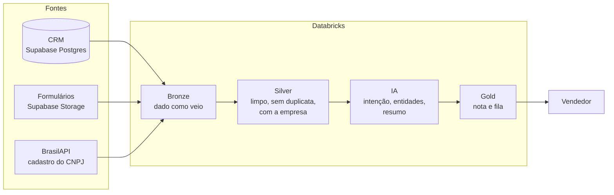

# Call First · Priorização inteligente de leads

> Um pipeline de dados com IA no Databricks que diz ao vendedor **para quem ligar primeiro**, **por quê** e **o que dizer**.

Projeto do workshop "Engenharia de dados + IA aplicada a vendas". O cliente é a **Atlas Software**, uma empresa fictícia de software B2B. Os dados são sintéticos, gerados com seed fixa por [`gerar_dados.py`](gerar_dados.py). A especificação completa está no [PRD](PRD.md).

**Índice**

- [Parte 1 · O projeto](#parte-1--o-projeto)
  - [O problema](#o-problema)
  - [O que o Call First entrega](#o-que-o-call-first-entrega)
  - [Valor para o negócio](#valor-para-o-negócio)
  - [Como funciona](#como-funciona)
  - [Onde estamos](#onde-estamos)
  - [Estrutura do repositório](#estrutura-do-repositório)
  - [Como rodar](#como-rodar)
- [Parte 2 · Guia de estudo](#parte-2--guia-de-estudo)

---

# Parte 1 · O projeto

## O problema

A Atlas Software vende 5 produtos por assinatura (Atlas Gestão, BI, Fiscal, CRM e Estoque) com um time de **8 vendedores**. O time recebe cerca de **300 leads por semana** e os atende **por ordem de chegada**. O vendedor não sabe quem está pronto para comprar (origem: `PRD.md` §1.2 e §1.3).

O resultado é previsível:

- leads com intenção de compra **esfriam na fila**;
- o time gasta tempo com **curiosos, pedidos de suporte e spam**;
- a conversão de lead em venda fica em torno de **3 %**.

**Por que isso acontece (causa-raiz, `PRD.md` §1.4).** A informação que mostra a intenção do lead está espalhada em três lugares:

| Onde está | O que diz |
|---|---|
| o histórico no **CRM** | quem é o lead, se já comprou, quem o atende |
| o **texto livre do formulário** | o que o lead quer, com as palavras dele |
| o **cadastro da empresa** na Receita | o porte e o ramo da empresa |

Nenhum sistema junta esses três lugares, e ninguém interpreta o texto livre: hoje o vendedor lê cada mensagem.

## O que o Call First entrega

Uma tabela, a **`gold.fila_priorizada`**, com um lead por linha, já na ordem de atendimento. Para cada lead ela traz:

| O quê | Exemplo |
|---|---|
| **Posição na fila** e **nota de 0 a 100** | 1º lugar, nota 93 |
| **Intenção** lida pela IA na mensagem | compra imediata, pesquisa, suporte ou spam |
| **Os 4 componentes da nota**, para o vendedor confiar nela | intenção 100 · porte 100 · histórico 100 · recência 50 |
| **Resumo** da mensagem em até 15 palavras | "Trocando de sistema" |
| **Próximo passo** sugerido | "Contatar o lead", "Encaminhar ao suporte", "Descartar" |
| **Entidades** extraídas da mensagem | produto, quantidade, prazo, orçamento |
| **Empresa** pela BrasilAPI | razão social, porte, ramo (CNAE), situação |
| Situação no CRM | vendedor, região, status |

Quem usa (`PRD.md` §1.5):

- **Vendedor**: para quem ligar primeiro e o que dizer.
- **Gestor comercial**: distribuir os leads e cobrar o time com dados.
- **Marketing**: saber quais canais e campanhas trazem leads quentes.

A IA **sugere**; quem decide é o vendedor (`PRD.md` §2.7).

## Valor para o negócio

**A aposta (hipótese de valor, `PRD.md` §1.6).** Se juntarmos CRM, formulários e cadastro da empresa num pipeline só, e a IA ler a intenção do texto livre, o time liga primeiro para quem tem mais chance de comprar. Assim a conversão sobe **sem aumentar o time**.

**Como vamos saber se deu certo (`PRD.md` §1.7):**

| Métrica | Meta | Situação |
|---|---|---|
| ⭐ Conversão lead → oportunidade no **top 20 % da fila** | ≥ 2× a linha de base | ⏳ falta o backtest (`PRD.md` §3.3) |
| Leads "compra imediata" contatados em até 24 h | ≥ 90 % | ⏳ medida em produção |
| Tempo até o 1º contato de um lead quente | −50 % | ⏳ medida em produção |
| Acurácia da IA na intenção | ≥ 85 % | ✅ **96,5 %** (164 de 170 mensagens) |
| Leads duplicados na silver | 0 | ✅ 0 |

Em uma frase: **o pipeline já funciona e a IA acerta a intenção em 96,5 % dos casos, mas ainda falta provar com o histórico que a fila converte o dobro.**

## Como funciona



As três camadas seguem a **arquitetura medalhão**:

- **Bronze** guarda o dado como veio da fonte, para sempre poder reprocessar.
- **Silver** limpa (CNPJ, e-mail), remove duplicatas, junta CRM e formulários num lead só e acrescenta a empresa.
- **Gold** aplica a IA, calcula a nota e publica a fila.

**A nota de prioridade** (`PRD.md` §2.6):

```
nota = 0,50 × intenção + 0,20 × porte + 0,15 × histórico + 0,15 × recência
```

| Componente | Vem de | Como vira 0–100 |
|---|---|---|
| Intenção (50 %) | IA na mensagem | compra imediata 100 · pesquisa 40 · suporte 10 · spam 0 · sem mensagem 20 |
| Porte (20 %) | BrasilAPI | grande ("DEMAIS") 100 · pequeno porte 60 · micro 30 · desconhecido 20 |
| Histórico (15 %) | CRM | taxa de conversão da empresa (ou do ramo), escalada entre a menor e a maior |
| Recência (15 %) | data da mensagem | 100 no dia, caindo até 0 em 30 dias |

**Travas:** `spam` nunca passa de 5 e o próximo passo é "Descartar"; `suporte` nunca passa de 25 e o próximo passo é "Encaminhar ao suporte". Assim, um erro da IA no peso maior não leva spam ao topo.

Tudo roda num **job diário** do Databricks (`bronze_ingest`), de ponta a ponta:

```
ingerir_crm ┐
            ├─► consultar_cnpj ─► pipeline call_first_etl ─► enriquecer_ia ─► pipeline call_first_gold
copiar_form ┘   (BrasilAPI)       (bronze form. + silver)    (IA incremental)   (nota e fila)
```

## Onde estamos

| Entrega | Status |
|---|---|
| Fontes no Supabase e conexão testada | ✅ |
| Perfil dos dados, metadados e data contracts | ✅ |
| Bronze: CRM, formulários e cache da BrasilAPI | ✅ |
| Silver: limpeza, deduplicação e enriquecimento | ✅ |
| Gold: IA, nota e fila priorizada | ✅ |
| Validação com o lote ao vivo | ✅ feita; 1 critério falhou (CA-08) |
| Classificação v2 (corrigir as pegadinhas) | ⏳ adiada |
| Backtest da nota com o histórico | ⏳ |
| Painel e Genie | ⏳ |
| Publicação em `prod` | ⏳ só o `dev` foi publicado |

Critérios de aceite medidos (`PRD.md` §3.1). A origem é [`knowledge/architecture/databricks.md`](knowledge/architecture/databricks.md).

| Critério | O que pede | Resultado |
|---|---|---|
| CA-02 | lote ao vivo gera exatamente 20 registros; rodar de novo gera 0 | ✅ 20, depois 0 |
| CA-03 | 2ª execução faz 0 chamadas à BrasilAPI | ✅ 0 |
| CA-04 | CNPJ com e sem máscara convergem; os 3 inválidos ficam `cnpj_valido = false` | ✅ |
| CA-05 | 0 e-mails duplicados na silver; o duplo clique aparece 1 vez | ✅ |
| CA-06 | lead sem CNPJ ou com CNPJ inválido chega à gold com empresa nula | ✅ |
| CA-07 | acurácia ≥ 85 % contra o gabarito | ✅ 96,5 % |
| CA-08 | ≥ 4 das 5 pegadinhas certas | ❌ **3 de 5** |
| CA-09 | "200 licenças": produto, quantidade e prazo certos | ✅ |
| CA-10 | nenhum spam acima de 5, nenhum suporte acima de 25 | ✅ |
| CA-11 | fila ordenada e com os 4 componentes em todo lead | ✅ |
| CA-14 | 2ª execução sem dado novo faz 0 chamadas de IA | ✅ 0 |
| CA-01, CA-12, CA-13 | lead novo no CRM, Genie e tempo ponta a ponta | ⏳ não medidos |

## Estrutura do repositório

| Pasta ou arquivo | O que é |
|---|---|
| [`PRD.md`](PRD.md) | a especificação do produto: problema, regras, critérios de aceite |
| [`call_first/`](call_first/) | o **bundle do Databricks**: jobs, pipelines e código (bronze, silver, gold) |
| [`supabase/`](supabase/) | o DDL e a carga do CRM, mais os leads "ao vivo" |
| [`storage/`](storage/) | os formulários (JSON Lines) e o script que os envia ao bucket |
| [`gabarito/`](gabarito/) | a intenção real de cada formulário, só para medir a IA |
| [`reports/`](reports/) | o perfil dos dados (página HTML) |
| [`metadata/`](metadata/) | cada tabela e coluna das fontes, com a origem de cada descrição |
| [`contracts/`](contracts/) | os data contracts das fontes (ODCS v3.1.0), com os pontos abertos |
| [`knowledge/`](knowledge/) | o que o projeto aprendeu: arquitetura, regras, decisões, fontes |
| [`skills/`](skills/) | o passo a passo de cada trabalho repetido (perfil, contrato, metadados...) |
| [`tools/metadata/`](tools/metadata/) | o script que extrai os metadados dos dados |
| [`databricks/`](databricks/) | o notebook de teste das 3 conexões |
| [`gerar_dados.py`](gerar_dados.py) | regenera todo o dado sintético (mesma seed, mesmo resultado) |
| [`test/`](test/) e `.github/workflows/ci.yml` | os testes, rodados no CI a cada push |

## Como rodar

**Pré-requisitos:** Databricks CLI com o perfil `pessoal` configurado, `uv` instalado e um `.env` na raiz com as variáveis do [`.env.example`](.env.example). O `.env` nunca vai para o git.

1. **Credenciais no Databricks**: as 10 chaves do `.env` ficam no secret scope `call_first` (`pg_host`, `pg_port`, `pg_database`, `pg_user`, `pg_password`, `s3_endpoint`, `s3_region`, `s3_access_key_id`, `s3_secret_access_key`, `s3_bucket`). Para trocar um valor: `databricks secrets put-secret call_first <chave> -p pessoal`.
2. **Publicar e rodar** (a partir de `call_first/`):

   ```bash
   databricks bundle validate --strict -t dev -p pessoal
   databricks bundle deploy -t dev -p pessoal
   databricks bundle run bronze_ingest -t dev -p pessoal
   ```

3. **Ver o resultado**: `SELECT * FROM call_first.gold.fila_priorizada ORDER BY posicao`.
4. **Demo do incremental**: suba o lote ao vivo (`python storage/upload_supabase_storage.py --lote`) e rode o job de novo. Só os 20 formulários novos entram e passam pela IA.
5. **Testes**: `python -m unittest discover -s test -v` (Python 3.12 ou superior).

<details>
<summary><b>Montar as fontes do zero (Supabase, Storage, BrasilAPI)</b></summary>

**Banco (Supabase Postgres)**

1. Crie o projeto no Supabase, de preferência na região São Paulo (sa-east-1).
2. Em `supabase/01_schema.sql`, troque `TROQUE_ESTA_SENHA` pela senha do usuário `databricks_reader`.
3. No SQL Editor, rode `01_schema.sql` e depois `02_seed.sql`.
4. Para restaurar entre ensaios, rode só o `02_seed.sql`: ele limpa e recarrega, com datas relativas a `now()`.
5. Conexão: use o **Session pooler** (porta 5432). A conexão direta do Supabase é só IPv6, e o pooler aceita IPv4. O usuário fica no formato `databricks_reader.<PROJECT_REF>`.

**Arquivos (Supabase Storage)**

1. Crie um bucket privado.
2. Em Project Settings → Storage → S3 Access Keys, gere o par de chaves e anote endpoint e região.
3. Suba a carga inicial com `storage/upload_supabase_storage.py` (`--lote` durante a demo, `--limpar` para resetar).

**API (BrasilAPI)**

Os leads usam CNPJs de matriz de 30 empresas reais e públicas, todos com dígito verificador válido, mais 3 CNPJs inválidos de propósito. A API pública tem limite de chamadas, por isso o projeto guarda um cache e só consulta CNPJ novo.

**Rede no Databricks**

Na Free Edition, a saída para a internet pode ser restrita. Teste primeiro com `databricks/00_teste_conexoes.py`. Neste workspace, o serverless alcança o Postgres, o Storage e a BrasilAPI (testado em 2026-11-01).

</details>

---

# Parte 2 · Guia de estudo

## Como usar este guia

Leia as etapas **na ordem**: cada uma usa o que a anterior produziu. Todas seguem o mesmo formato:

- **O que fizemos**: a ação, em poucas linhas.
- **Por quê**: o problema que ela resolve.
- **Decisões**: as escolhas feitas e o motivo de cada uma.
- **Resultado**: o que saiu, com números medidos.
- **Para explicar em uma frase**: como contar a etapa para alguém.

No fim do guia estão as decisões numa tabela só, os conceitos para dominar e as perguntas que podem te fazer.

## Mapa das etapas

| # | Etapa | O que saiu | Onde está |
|---|---|---|---|
| 0 | Preparação | fontes no Supabase, conexão testada | `supabase/`, `storage/`, `.env` |
| 1 | Bundle Databricks | o projeto Databricks versionado | `call_first/` |
| 2 | Perfil dos dados | os problemas dos dados, medidos | `reports/profile_crm_formularios.html` |
| 3 | Metadados e contratos | o que cada coluna é e o que cada fonte garante | `metadata/`, `contracts/` |
| 4 | Bronze | o dado como veio, no Databricks | `call_first.bronze.*` |
| 5 | Silver | o dado limpo, um lead por pessoa | `call_first.silver.*` |
| 6 | Gold | a IA, a nota e a fila | `call_first.gold.*` |
| 7 | Validação ao vivo | os critérios de aceite medidos | `knowledge/architecture/databricks.md` |

## Etapa 0 · Preparação

**O que fizemos.** Montamos as três fontes:
- o **CRM** no Supabase Postgres (schema `crm`: vendedores, produtos, leads, oportunidades, interações);
- os **formulários** em JSON Lines num bucket do Supabase Storage;
- a **BrasilAPI**, para o cadastro da empresa pelo CNPJ.

Depois testamos a conexão de cada uma com as credenciais do `.env` e listamos o bucket e os catálogos do Databricks.

**Por quê.** Sem acesso às fontes não há pipeline. E na Free Edition do Databricks a saída para a internet pode ser bloqueada, então testar a rede vem antes de tudo (`PRD.md` §3.4, risco nº 1).

**Decisões.**
- O banco é acessado por um **usuário somente leitura**: a plataforma de dados nunca escreve no sistema de origem (`PRD.md` RNF-03).
- O acesso é pelo **Session pooler**, porque a conexão direta é só IPv6 (`PRD.md` D-01).
- Todo objeto do projeto fica no catálogo **`call_first`**, e todo comando usa o perfil **`pessoal`** do CLI (`CLAUDE.md`).

**Resultado.** As três fontes respondem. O catálogo `call_first` tem os schemas `bronze`, `silver` e `gold`.

**Para explicar em uma frase.** "Antes de construir, garantimos acesso só de leitura às três fontes e testamos a rede."

## Etapa 1 · Bundle Databricks (DABs)

**O que fizemos.** Criamos o projeto Databricks como um **bundle** (Declarative Automation Bundles) na pasta `call_first/`. O bundle tem dois ambientes, `dev` e `prod`, e variáveis para catálogo e schemas.

**Por quê.** Com o bundle, jobs, pipelines e código ficam no git, revisados e publicados com um comando, em vez de configurados à mão na tela. Isso dá reprodutibilidade e governança (`PRD.md` RNF-04).

**Decisões.**
- O template usado foi o `default-python`, com o código de exemplo removido depois.
- As variáveis `schema_bronze`, `schema_silver` e `schema_gold` seguem o medalhão.
- **Ponto em aberto:** dev e prod usam os mesmos schemas.

**Resultado.** `bundle validate --strict` passa nos dois ambientes. Só o `dev` foi publicado.

**Para explicar em uma frase.** "Toda a infraestrutura do Databricks está em código, versionada e publicável com um comando."

## Etapa 2 · Perfil dos dados

**O que fizemos.** Antes de escrever qualquer pipeline, **medimos** os dados com scripts: formato, schema, nulos, duplicatas, valores inválidos, relações entre tabelas e dados pessoais. O resultado está numa página: [`reports/profile_crm_formularios.html`](reports/profile_crm_formularios.html).

**Por quê.** Construir sobre dado que não conhecemos gera retrabalho. O perfil mostra os problemas reais, com número, e cada problema vira uma regra de limpeza ou um acordo com a fonte.

**Decisões.**
- Contar com script, nunca adivinhar.
- Mascarar os dados pessoais na página.
- Classificar cada achado em "para o pipeline" ou "para o contrato".

**Resultado.** 873 linhas do CRM e 171 formulários. As chaves e as relações estão íntegras, e saíram **14 achados**. Os principais:

| Achado | Tamanho |
|---|---|
| CNPJ com dígito verificador inválido (3 valores falsos) | 48 leads (15 %) e 25 formulários |
| CNPJ em 2 formatos, com e sem máscara | 92 leads com máscara |
| Formulários de leads que já existem no CRM | 43 (25,1 %); só 18 casam pelo e-mail cru |
| E-mail com espaços e MAIÚSCULAS | 25 formulários |
| Envio duplicado (duplo clique) | F00008 = F00151 |
| Interação registrada 2 vezes | ids 336 e 337 |
| `produto_interesse` diverge do produto da mensagem | 41 de 50 |
| DDD que não existe no Brasil | 72 leads e 42 formulários |

**Para explicar em uma frase.** "Medimos os problemas dos dados antes de construir, e cada um virou uma regra de limpeza ou uma pergunta para o dono da fonte."

## Etapa 3 · Metadados e data contract

**O que fizemos.**
- **Metadados** ([`metadata/`](metadata/)): cada tabela e coluna, com nome, tipo e chave tirados dos dados por script ([`tools/metadata/extract_metadata.py`](tools/metadata/extract_metadata.py)) e descrições tiradas só de dois documentos, o DDL e o PRD.
- **Data contracts** ([`contracts/`](contracts/)): um por fonte, no padrão aberto **ODCS v3.1.0**, com o formato, o schema, as regras de qualidade, como a entrega acontece e os **pontos abertos** para o dono da fonte.

**Por quê.** O metadado diz o que cada coluna significa. O contrato diz o que a fonte **promete** entregar. Quando algo quebra, o contrato mostra se a culpa é da fonte ou do pipeline.

**Decisões.**
- Onde o documento não diz nada, a descrição **fica vazia**, em vez de inventada.
- O dono da fonte fica como papel genérico até a reunião, porque o repositório é público.
- O contrato não tem SQL nem transformação, só fatos e acordos.

**Resultado.**
- **Metadados:** 22 de 37 colunas do CRM e 5 de 11 campos dos formulários têm descrição.
- **Contratos:** os 2 passam no `datacontract lint`. São 8 pontos abertos no CRM e 9 nos formulários, como quem é o dono e se a interação 336/337 é duplicata.

**Para explicar em uma frase.** "Documentamos o que cada dado significa e o que cada fonte garante, sem inventar nada, e listamos o que falta combinar com os donos."

## Etapa 4 · Bronze: o dado como veio

**O que fizemos.** O job `bronze_ingest` grava as fontes no Databricks sem mudar nada:
- **CRM**: lido pelo Postgres. A tabela `crm_leads` é **incremental**: só entram as linhas com `atualizado_em` maior que o último já gravado. As outras 4 tabelas são substituídas inteiras a cada execução.
- **Formulários**: um script copia do bucket para um **Volume** só os arquivos novos, e o **Auto Loader** lê cada arquivo uma única vez.
- Toda linha ganha colunas técnicas: `_fonte`, `_ingerido_em` e, nos formulários, `_arquivo`.

**Por quê.**
- A bronze é a cópia fiel: se uma regra mudar, dá para refazer tudo a partir dela.
- Ler só o que mudou economiza tempo e custo.
- Reprocessar não pode duplicar nada (`PRD.md` RNF-01).

**Decisões.**
- **Incremental só em `leads`**, porque é a única tabela com coluna de atualização. As outras são pequenas e vão inteiras (contrato, ponto P-06).
- **Storage → Volume → Auto Loader**, porque o Unity Catalog não aceita um endpoint S3 fora da AWS (`PRD.md` D-02).
- As credenciais ficam num **secret scope**, nunca no código.

**Resultado.**

| Tabela | 1ª execução | 2ª execução |
|---|---|---|
| `crm_leads` | 320 | 320 (0 novas) |
| `crm_vendedores` · `crm_produtos` | 8 · 5 | iguais |
| `crm_oportunidades` · `crm_interacoes` | 109 · 431 | iguais |
| `formularios` | 151 | 151 (0 arquivos copiados) |

**Para explicar em uma frase.** "A bronze guarda o dado como veio, lê só o que é novo e pode rodar quantas vezes quiser sem duplicar."

## Etapa 5 · Silver: o dado limpo

**O que fizemos.** O pipeline `call_first_etl` monta a silver:
- **CNPJ**: só os dígitos, e o **dígito verificador** conferido (módulo 11). Inválido fica com `cnpj_valido = false`.
- **E-mail**: minúsculas e sem espaços (`email_norm`), a chave que liga CRM e formulários.
- **Duplo clique**: mesmo e-mail e mesma mensagem em até 5 minutos sai da tabela.
- **BrasilAPI**: a tarefa `consultar_cnpj` consulta só CNPJ válido e ainda não consultado, e guarda a resposta crua em `bronze.cnpj_api`. A silver monta `silver.empresas`.
- **Um lead por pessoa**: `silver.leads` junta CRM e formulários pelo e-mail. Fica o cadastro do CRM quando existe, mais a mensagem mais recente do formulário (`PRD.md` §2.6).
- **Expectations**: 15 regras de qualidade registradas a cada execução, em modo aviso.

**Por quê.** Os problemas do perfil viram regras automáticas, e a gold recebe um dado em que dá para confiar.

**Decisões.**
- **Sinalizar, não remover.** CNPJ inválido, DDD inexistente e a interação repetida ganham uma flag, mas ficam. Esses pontos ainda estão em aberto com o dono da fonte, e apagar agora perderia dado que pode ser legítimo. Só o duplo clique sai, porque o PRD manda (RF-07).
- Lead que veio só do formulário fica com `lead_id` nulo na silver. O ID é gerado na gold.
- A BrasilAPI entra junto com a silver. Uma falha da API não para o job: o CNPJ é tentado de novo na próxima execução (`PRD.md` RNF-06).

**Resultado.**
- `silver.formularios`: **150**, porque o duplo clique saiu.
- `silver.leads`: **428** e-mails únicos, sendo 320 do CRM e 108 só de formulário.
- **Sinalizados:** 48 CNPJs inválidos, 72 DDDs inexistentes e a interação 336/337.
- **BrasilAPI:** 30 CNPJs consultados, todos com resposta 200, e nenhum CNPJ inválido enviado à API. A 2ª execução não fez nenhuma consulta.

**Para explicar em uma frase.** "A silver aplica as regras do perfil, junta CRM e formulários num lead por pessoa e acrescenta a empresa, sem apagar o que ainda está em discussão."

## Etapa 6 · Gold: a IA, a nota e a fila

**O que fizemos.**
- **IA** (tarefa `enriquecer_ia`, tabela `gold.ia_formularios`):
  - `ai_classify` lê a **intenção**;
  - `ai_extract` tira **produto, quantidade, prazo e orçamento**;
  - `ai_query`, com um prompt fixo e um modelo Llama 3.3 70B, escreve o **resumo** e o **próximo passo**.
- **Nota e fila** (pipeline `call_first_gold`):
  - `historico_conversao`: a taxa de conversão por empresa, por ramo e geral;
  - `fila_priorizada`: a nota com os 4 componentes, as travas e a posição;
  - `avaliacao_ia`: a comparação com o gabarito.

**Por quê.** Ler a intenção no texto livre é o que nenhuma regra simples faz bem. A nota junta os quatro sinais num número só, e os componentes ficam visíveis para o vendedor entender a nota (`PRD.md` RNF-08).

**Decisões.**
- **IA incremental:** só formulário novo vai para a IA. Uma materialized view recalcularia toda a base a cada execução, então a IA ficou numa tarefa à parte com MERGE por `form_id` (`PRD.md` RNF-05, CA-14).
- **Auditoria:** o modelo e a versão do prompt são gravados em cada linha (`PRD.md` §2.7).
- **Mensagem muito curta:** abaixo de 5 caracteres, vira spam sem chamar a IA.
- **Lead sem mensagem:** entra na fila com intenção "sem mensagem" (componente 20) e próximo passo "Qualificar por contato".
- **Histórico:** a taxa é escalada entre a menor e a maior (min-max), porque com taxas em torno de 3 % o "× 100" quase não diferenciaria ninguém.
- **ID do lead só de formulário:** um número negativo derivado do e-mail, que nunca colide com o ID do CRM.

**Resultado.**
- **Fila:** 428 leads, notas de 5 a 93, os 4 componentes preenchidos em todos e as travas respeitadas.
- **Acurácia:** 146 de 150 na carga inicial.
- **2ª execução:** 0 chamadas de IA.
- **Porte:** as 30 empresas têm porte "DEMAIS", então hoje o porte só separa quem tem CNPJ válido de quem não tem.

**Para explicar em uma frase.** "A IA lê a intenção da mensagem, a regra transforma quatro sinais numa nota de 0 a 100, e a fila mostra a nota e o motivo."

## Etapa 7 · Validação com o lote ao vivo

**O que fizemos.** Subimos o lote ao vivo: 20 formulários novos, entre eles **5 pegadinhas** feitas para enganar uma regra de palavra-chave. Depois rodamos o job duas vezes e medimos os critérios de aceite.

**Por quê.** É o teste do valor da IA: ela precisa acertar onde a palavra-chave erra. O incremental também precisa funcionar de verdade, com dado chegando.

**Resultado.**

| Pegadinha | Esperado | IA (prompt v1) |
|---|---|---|
| compra escondida em texto informal ("200 licenças… até dezembro") | compra imediata | ✅ compra imediata |
| "Não é suporte! … quero CONTRATAR" | compra imediata | ✅ compra imediata |
| "comprar uma solução" para um erro do sistema | suporte | ❌ compra imediata |
| "Urgente!!!" de estudante | pesquisa | ✅ pesquisa |
| spam com "COMPRE AGORA" | spam | ❌ compra imediata |

- **CA-08 falhou: 3 de 5** (a meta era 4). Os dois erros são justamente as armadilhas de palavra-chave: "comprar" e "compre" puxaram a IA para compra imediata. Por isso esses dois leads ficaram no meio da fila, com nota 76, em vez de no fim.
- **Os outros critérios passaram:** 20 registros novos e depois 0; acurácia de **96,5 %** (164 de 170); a extração das "200 licenças" certa; 0 chamadas de IA na repetição.
- **A fila cresceu** de 428 para **448** leads, ainda um por e-mail: os números das etapas 5 e 6 são de antes do lote.
- **Proposta, adiada:** uma classificação **v2**, com um prompt que define cada intenção. Ficou registrada como decisão em aberto.

**Para explicar em uma frase.** "No teste ao vivo, a IA acertou 96,5 % no geral, mas caiu em 2 das 5 pegadinhas de palavra-chave, e isso é o que a próxima versão precisa corrigir."

## As decisões em uma tabela

| Decisão | Motivo | O que descartamos |
|---|---|---|
| Usuário de banco só leitura | a plataforma nunca escreve na origem | usar o usuário `postgres` |
| Bundle (DABs) para tudo | infraestrutura versionada e reprodutível | configurar à mão na tela |
| Perfil antes do pipeline | conhecer os problemas com número | descobrir os problemas em produção |
| Descrição vazia quando o documento é silencioso | metadado confiável | descrição "chutada" pelo nome da coluna |
| `leads` incremental, o resto completo | só `leads` tem coluna de atualização | incremental em tudo, sem marca confiável |
| Storage → Volume → Auto Loader | endpoint S3 fora da AWS não vira external location | ler o S3 direto |
| Sinalizar, não remover | os pontos ainda estão em aberto com a fonte | apagar CNPJ inválido e a interação repetida |
| Só CNPJ válido vai à BrasilAPI | economiza chamadas e evita erro conhecido | consultar todos |
| IA numa tarefa incremental | não pagar IA pela base inteira a cada dia | IA dentro de uma materialized view |
| Travas de spam e suporte | um erro da IA não leva lixo ao topo | só a soma ponderada |
| Histórico min-max | diferenciar leads com taxas baixas | taxa × 100 |
| Lead sem mensagem com intenção 20 | não sumir com 279 leads do CRM | tirá-los da fila |
| v2 da classificação adiada | decisão do engenheiro de dados | — |

## Conceitos para dominar

| Conceito | Em palavras simples |
|---|---|
| **Arquitetura medalhão** | três camadas: bronze (como veio), silver (limpo) e gold (pronto para o negócio) |
| **Idempotência** | rodar de novo dá o mesmo resultado, sem duplicar nada |
| **Watermark (marca d'água)** | o maior `atualizado_em` já gravado; a próxima carga só lê o que for maior |
| **Carga incremental × completa** | ler só o que mudou × ler a tabela inteira de novo |
| **Auto Loader** | lê arquivos novos de uma pasta, cada um uma única vez |
| **Streaming table × materialized view** | a primeira só acrescenta linhas novas; a segunda é recalculada a partir das tabelas de origem |
| **Expectation** | uma regra de qualidade que o pipeline confere e registra a cada execução |
| **Dígito verificador do CNPJ** | os 2 últimos dígitos são calculados a partir dos 12 primeiros; se não batem, o CNPJ é falso |
| **Data contract** | o acordo escrito com a fonte: o que ela entrega, em que formato e com que garantias |
| **AI Functions** | funções SQL do Databricks que chamam um LLM: `ai_classify`, `ai_extract`, `ai_query` |
| **Gabarito** | a resposta certa de cada mensagem, usada só para medir a IA, nunca na nota |
| **Travas** | limites da nota que valem mesmo se a soma der mais |
| **Secret scope** | o cofre de senhas do Databricks; o código lê a senha sem ela aparecer |

## Perguntas que podem te fazer

**Por que não usar só uma regra de palavra-chave?**
Porque "comprar" aparece em pedido de suporte e em spam, e "urgente" aparece em mensagem de estudante. A IA lê o contexto: acertou 96,5 % no geral. As pegadinhas mostram que ela ainda erra justamente onde a palavra engana, e é por isso que existe a v2 proposta.

**A IA roda toda vez que o job roda?**
Não. Só o formulário que ainda não passou pela IA é enviado. Na 2ª execução foram 0 chamadas, o que mantém o custo proporcional ao volume novo.

**E se a BrasilAPI cair?**
O job continua. O lead segue sem os dados da empresa, e o CNPJ é tentado de novo na próxima execução.

**Por que o porte quase não muda a nota?**
Porque as 30 empresas do dataset são grandes ("DEMAIS"). Hoje o porte só separa quem tem CNPJ válido de quem não tem. Com dados reais, ele diferenciaria mais.

**Como o vendedor confia na nota?**
A fila mostra os 4 componentes de cada nota, o resumo da mensagem e o próximo passo. A IA sugere, e o vendedor decide.

**Como vocês sabem que não há lead duplicado?**
A chave da silver é o e-mail normalizado: 428 leads e 428 e-mails distintos. O duplo clique sai pela regra dos 5 minutos.

**Por que o CNPJ inválido não foi apagado?**
Porque ainda não sabemos com o dono do CRM se ele é erro de digitação ou de cadastro. A silver marca o CNPJ como inválido, ele não vai à API, e a decisão fica registrada.

**Os dados pessoais estão protegidos?**
As credenciais estão no secret scope e o banco é só leitura. Os dados pessoais só aparecem onde o vendedor precisa (`fila_priorizada`). A avaliação da IA não tem dado pessoal, e o perfil mostra tudo mascarado.

**O que falta para produção?**
Corrigir as pegadinhas (v2), provar o valor com o backtest, construir o painel e o Genie, separar dev de prod, fechar os pontos abertos com os donos das fontes e tirar a URL do workspace e o e-mail do `databricks.yml`.

## Próximos passos

1. **Classificação v2**: definir cada intenção no prompt e comparar v1 × v2 em `gold.avaliacao_ia` (CA-08).
2. **Backtest** (`PRD.md` §3.3): os leads do top 20 % da nota converteram 2× mais que a média?
3. **Painel e Genie** (`PRD.md` RF-15, RF-16).
4. **Separar dev de prod**: outro catálogo ou prefixo de schema no bundle.
5. **Pontos abertos com os donos das fontes**: listados nos [contratos](contracts/) e no [registro de decisões](knowledge/decisions/decision-log.md).
6. **Repositório público**: tirar a URL do workspace e o e-mail do `call_first/databricks.yml`.

Para ir mais fundo: [`knowledge/README.md`](knowledge/README.md) é o índice de tudo o que o projeto aprendeu.

<details>
<summary>Como este projeto foi criado</summary>

```bash
# 1. Cria o projeto Python com a versão desejada
uv init Call_Firt --python 3.12
cd Call_Firt

# 2. Inicializa o Git e faz o primeiro commit
git init
git add .
git commit -m "Initial commit"

# 3. Cria o repositório público no GitHub, associa o remoto e faz o push
gh repo create Call_Firt --public --source=. --remote=origin --push
```

</details>